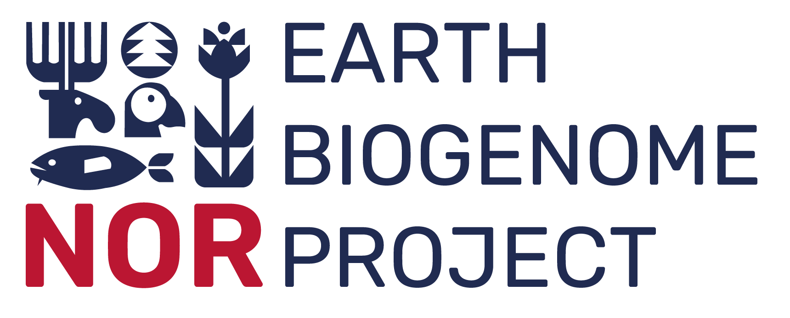

# Telomere-to-telomere genome assembly - workshop 2026

This repository contains the course materials for the telomere-to-telomere genome assembly given at [OBiWOW 2026](https://www.mn.uio.no/bils/english/events/oslo-bioinfomatics-week/oslo-bioinformatics-workshop-week-2026/). 

This course is given by [ELIXIR Norway](https://elixir.no/) and builds on material developed in and for [EBP-Nor](https://www.ebpnor.org/). 

The course is run on infrastructure provided by [Sigma2](https://www.sigma2.no/).

Go here to start: (genome_assembly/README.md) deals with genome assembly, evaluation and curation. 

  

